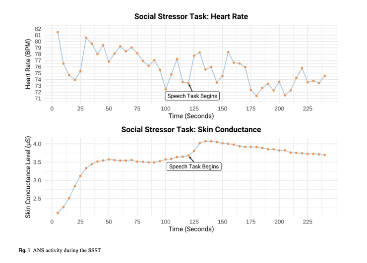
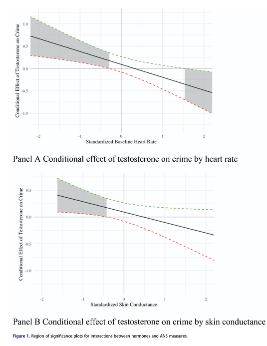
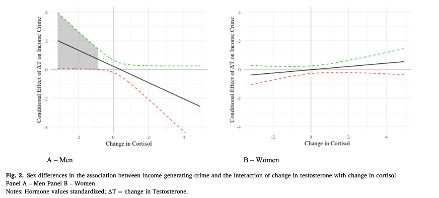

Below, you'll find a selection of plots from published work. There are links to the publications as well. 

  

 

Time-series plot from [*Differences in Associations Between Autonomic Nervous System Activity and Psychopathic Traits Across Stress Paradigms and Measures*](https://link.springer.com/article/10.1007/s10862-024-10185-6)

 

  

 

Johnson-Neyman Interaction Plot (two-way interaction) from [*Hormones, autonomic nervous system activity, and criminal behavior*](https://doi.org/10.1080/0735648X.2024.2382985)

 

  

 

Johnson-Neyman Interaction Plot (three-way interaction) from [*Testosterone, cortisol, and criminal behavior in men and women*](https://www.sciencedirect.com/science/article/abs/pii/S0018506X22001544)